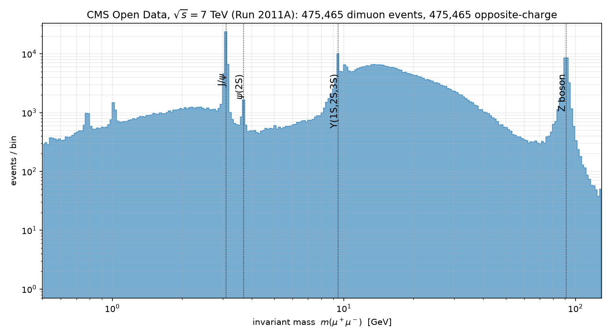
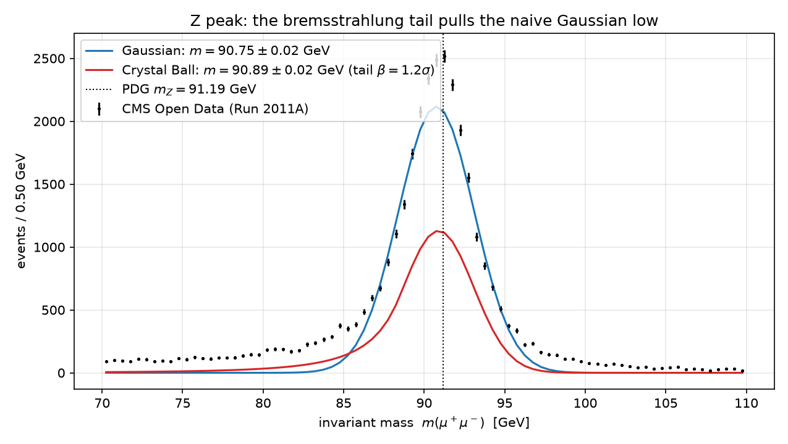
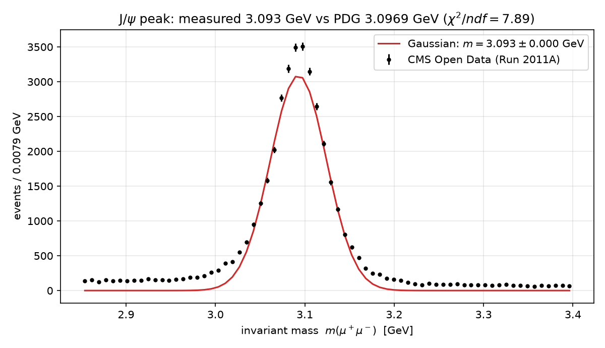

# rediscovering-particles — the LHC dimuon spectrum, one peak at a time

**475,465 real muon pairs from CMS (LHC Run 2011A, √s = 7 TeV), analyzed from
scratch in Python.** The invariant masses are recomputed from the raw
four-momenta, plotted as the famous dimuon spectrum, and the J/ψ and Z peaks
are fitted and compared with PDG values — including a quantitative lesson in
why *systematics*, not statistics, dominate precision measurements at the LHC.

No peak positions were hard-coded anywhere: every number below was measured
by this code from the data.

## The physics in one minute

When a heavy particle (J/ψ, Υ, Z...) is produced in a proton–proton collision
and decays to μ⁺μ⁻, the invariant mass of the muon pair

```
m² = (E₁ + E₂)² − |p₁ + p₂|²
```

equals the parent's mass. Stack 475k collision events into one histogram and
invisible particles reappear as peaks. Muons also radiate (bremsstrahlung) on
their way out of the detector, shifting some events to *lower* reconstructed
mass — which is why the Z peak needs a Crystal Ball lineshape (Gaussian core +
low-mass power-law tail), not a plain Gaussian.

## Results

### The spectrum

| | |
|---|---|
|  | From 0.5 to 130 GeV: the J/ψ, ψ(2S), Υ family and the Z boson — every bump is a particle rediscovered. Raw data in `results/dimuon_spectrum.csv`. |

### Peak measurements vs PDG

| Quantity | Reference | Measured (this code) |
|---|---|---|
| Our masses vs published column (median) | 0 (same events) | 4.9 × 10⁻⁵ GeV |
| Our masses vs published column (99.9% quantile) | — | 0.014 GeV |
| J/ψ mass | 3.0969 GeV | 3.093 GeV (−0.13%) |
| Z mass, Gaussian model | 91.1876 GeV | 90.754 ± 0.016 GeV |
| Z mass, Crystal Ball model | 91.1876 GeV | **90.892 ± 0.021 GeV** |
| Z low-mass tail | — | starts at β ≈ 1.2σ, power ≈ 3.5 |
| Z peak resolution σ | 2.50 GeV (natural width) | ≈ 2.2 GeV (detector-dominated) |

| | |
|---|---|
|  | The naive Gaussian sits ~0.43 GeV below PDG. Adding the physical bremsstrahlung tail moves the fitted mass **+0.14 GeV toward the PDG value** and halves χ²/ndf (17.3 → 9.0): the tail is real, measured at 12σ+ significance. |
|  | The J/ψ: ~31,000 signal events, core width 31 MeV — this dataset's tracker resolution for low-momentum muons. |

### The lesson: statistics ≠ truth

The statistical error on the Z mass is **16–21 MeV**, yet the measured mass
sits **300–430 MeV** below the PDG value. At LHC event counts the statistical
error shrinks to almost nothing, and the result is dominated by (a) physics
modeling (the tail, worth +140 MeV, as demonstrated above) and (b) the dataset
itself — this educational release has no final detector calibration. This is
exactly why CERN quotes systematic error tables next to every measurement,
and why the naive "±0.016 GeV" above must not be taken as the uncertainty of
the *physics*.

A related data-quality finding is documented in the tests: 94 of 475,465 rows
(0.02%) disagree with the published mass column by >50 MeV, including an
implausible 8.7 TeV muon at a 7 TeV collider — real analyses apply quality
cuts for exactly this reason.

## Methods

- **Kinematics**: vectorized `numpy` invariant mass from Cartesian 4-momenta;
  an independent `(pt, η, φ)` route exists for NanoAOD input, cross-validated
  by tests against analytic limits (muons at rest, back-to-back pairs).
- **Selection**: opposite-charge pairs (all 475,465 events in this curated
  DoubleMu sample pass it).
- **Fitting**: binned least squares with Poisson errors √(N+1), parameter
  uncertainties from the `curve_fit` covariance matrix; models: Gaussian +
  linear background, and Crystal Ball + exponential background.
- **Tests as physics checks**: hand-computable limits, agreement with the
  mass column published with the dataset, and fits that must recover peaks
  *injected* with known mass/width/tail into synthetic spectra.

## Repository layout

```
rediscovering-particles/
├── src/dimuon/
│   ├── physics.py     # invariant mass (two routes), PDG constants
│   ├── data.py        # CSV loader, selections, dataset download
│   ├── fitting.py     # Gaussian+linear and CrystalBall+exp fitters
│   └── nanoaod.py     # same objects straight from NanoAOD ROOT files (uproot)
├── scripts/
│   ├── download_data.py   # fetches the 72 MB dataset (gitignored)
│   ├── run_spectrum.py    # the money plot
│   └── run_peaks.py       # J/psi + Z fits, both Z models
├── tests/             # 10 physics tests (pytest)
├── figures/           # generated plots (committed)
└── results/           # generated CSV data (committed)
```

## Quickstart

```bash
python -m venv .venv
# Windows: .venv\Scripts\activate   |   Linux/macOS: source .venv/bin/activate
pip install -r requirements.txt
pip install -e .

python scripts/download_data.py    # 72 MB of real CMS Open Data
pytest                              # 10 physics tests, ~2 s
python scripts/run_spectrum.py
python scripts/run_peaks.py
```

Reading NanoAOD ROOT files instead of the CSV (as a full CMS analysis would):

```python
from dimuon.nanoaod import load_dimuon_from_root
events = load_dimuon_from_root("path-or-URL-to-nanoaod.root")
```

## Data source

CMS Run 2011A DoubleMu dimuon sample, released by the
[CERN Open Data portal](http://opendata.cern.ch) for education
([cms-opendata-education/zboson-exercise](https://github.com/cms-opendata-education/zboson-exercise)).
The dataset is not committed (72 MB); `scripts/download_data.py` fetches it.

## Roadmap

- [ ] Scale to the full 2012 NanoAOD dimuon dataset via uproot over HTTP
- [ ] Υ(1S,2S,3S) fits and mass-difference measurements
- [ ] Signal significance (local p-value) for the Z window
- [ ] Compare fitter performance against `iminuit`

## References

- Particle Data Group, *Review of Particle Physics* (masses and widths)
- J. Gaiser, PhD thesis (SLAC, 1982) — the Crystal Ball lineshape
- CERN Open Data portal: education materials on the dimuon spectrum
- Cowan, *Statistical Data Analysis* (binned LSQ, covariance-based errors)

## License

MIT — see [LICENSE](LICENSE).
